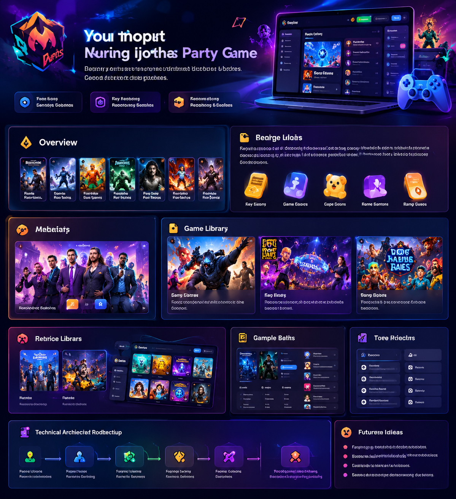

# Party Hub — Product & Technical Blueprint V1

> **Purpose:** Give Antigravity a durable product specification for building a modular, multiplayer party-game platform that can grow by adding independent games without rebuilding the application.
>
> **Working principle:** Build the platform once; add games as modules.



*Visual reference only: use the overall dark, polished, neon-accented gaming direction. Do not copy the generated image's garbled placeholder text or treat its UI as a pixel-perfect specification.*

---

## 1. Product vision

Create a browser-based party-game hub where friends can enter a private room, choose from a growing library of short competitive games, play together, compare results, and rematch.

The initial inspiration is the YouTube-style challenge format:

- Who can build the better team with a fixed budget?
- Choose five characters to defend against the remaining five.
- Who is more popular?
- Blind ranking, survival choices, auctions, and other random-topic competitions.

The platform should eventually support very different game mechanics—not just variations of team building.

### Product principles

1. **Modular:** each game is an independent module with a standard lifecycle and interface.
2. **Multiplayer-first:** room creation, joining, reconnection, and match synchronisation are platform services, not duplicated game code.
3. **Mobile-first:** comfortable on phones, while also working well on desktop.
4. **Fast to understand:** a player should understand the basic rules quickly.
5. **Replayable:** random topics, modifiers, rematches, and varied modes create repeat sessions.
6. **Reliable before expansive:** protect working games and test every new addition.
7. **Incremental development:** preserve the last stable build; do not rewrite the whole app for each feature.

## 2. Target experience and main navigation

The product should feel like a polished gaming platform, not a plain list of links.

### Main sections

| Section | Purpose |
|---|---|
| Home | Featured games, continue/recent activity, quick room actions |
| Game Library | Browse and filter all available games |
| Versus | Direct competitive games |
| Draft & Build | Auctions, budget drafts, team construction |
| Battle & Survival | Attack/defend, counters, survival scenarios |
| Popularity & Rankings | Comparisons, higher/lower, blind ranking |
| Trivia & Guessing | Movie clues, facts, quizzes |
| Custom | User-selected topics, rules, and presets |
| Profile | Stats, achievements, match history, favourites |

These are discovery categories. They should not require separate applications or separate multiplayer systems.

### Core user journey

1. Open the site.
2. Choose **Play with a Friend** or browse games.
3. Create a private room or enter a room code/invite link.
4. Both players join the lobby and confirm readiness.
5. Host selects a game and settings.
6. The game starts and both clients receive the same match setup.
7. Players complete the match.
8. Results show the winner, score, and a short explanation.
9. Players can rematch, change game, or return to the library.

### Lobby requirements

- Room code that is easy to copy and share.
- Shareable invite URL where practical.
- Player names and avatars/colours.
- Host indicator.
- Ready state.
- Selected game and settings.
- Start button enabled only when requirements are met.
- Leave room and host kick controls.
- Clear connection status for each player.
- Rematch and return-to-lobby actions after a match.

## 3. Visual direction and UI requirements

### Art direction

- Dark navy/charcoal base, with restrained electric blue, violet, and occasional orange accents.
- Strong contrast and readable typography.
- Rounded cards, clear hierarchy, subtle gradients, restrained glow.
- Game artwork or topic thumbnails should make the library visually engaging.
- Use consistent spacing, button styles, card sizes, icons, and feedback states.
- Avoid excessive neon, visual clutter, tiny text, or animation that slows down gameplay.
- Provide visible loading, empty, error, disconnected, and success states.

### Screens to design

1. **Home dashboard:** featured game, quick play, recent games, categories.
2. **Game library:** searchable/filterable game cards with short descriptions and player counts.
3. **Game details:** overview, instructions, supported player count, estimated duration, available modes.
4. **Multiplayer lobby:** room code, players, ready status, settings, start.
5. **Gameplay:** game-specific board/cards plus shared timer, player status, chat/reactions where appropriate.
6. **Results:** winner, score breakdown, explanation, rematch.
7. **Profile/rivalry:** match history, head-to-head record, favourite games, achievements.
8. **Diagnostics:** optional developer panel for room, connection, phase, state version, and recent events.

### UX requirements

- Responsive layouts for narrow phones first; no horizontal overflow.
- Large touch targets and clear selection feedback.
- Keyboard accessibility on desktop.
- Respect reduced-motion preferences.
- Use consistent modal, toast, confirmation, and error patterns.
- Keep rules accessible during a match.
- Confirm destructive actions such as resetting or leaving an active match.

## 4. Game library: initial concepts

The library must be data-driven. Each game registers metadata such as ID, title, category, description, supported player count, estimated duration, thumbnail, and module entry point.

### First three flagship games

#### A. Budget Draft — “Build the Better Team”

**Core loop**
1. Both players receive the same topic, item pool, and budget.
2. Players choose entities to build a team.
3. Selection mode can be snake draft, simultaneous pick, or live auction.
4. Validate budget, roster size, and category restrictions.
5. Reveal teams.
6. Evaluate using transparent criteria or player voting.
7. Show score breakdown and rematch.

**Possible topics:** cricket, football, superheroes, movie characters, anime, Pokémon, Indian actors, Hollywood actors, villains, fictional armies, video games, historical figures.

**Modes and modifiers**
- Snake draft.
- Simultaneous selection.
- Live auction.
- Hidden picks until reveal.
- Random budget.
- Maximum picks from one franchise/country.
- Special one-use cards (for example, swap or bonus budget).
- Team-chemistry bonuses only when rules are explicit and testable.
- Scenario-based team evaluation.

Do not make every version an auction. The selection format should be a configurable game mode.

#### B. Five vs Five — Attack & Defend

**Core loop**
1. Generate a pool of ten entities.
2. One side selects five defenders; the remaining five form the attacking side (or let both players build teams in an alternate mode).
3. Generate a scenario and win condition.
4. Resolve the encounter using visible, explainable rules.
5. Show the outcome and reasoning.

**Scenario examples**
- Defend a city for 24 hours.
- Protect a VIP.
- Survive an alien invasion.
- Capture a fortress.
- Stop a disaster.
- Defend against a zombie outbreak.

**Important:** Avoid an unexplained random winner. Outcomes should be based on disclosed attributes, matchup rules, player decisions, or a clearly labelled community vote.

#### C. Popularity Battle

**Core loop**
1. Show two entities from the same category.
2. Players independently choose which is more popular.
3. Reveal the answer and source/measurement date.
4. Award points and continue a streak or multi-round match.

**Possible metrics/modes**
- Social following.
- Box office or commercial reach.
- Search interest.
- Awards or achievements.
- Blind ranking of five entities.
- Guess-the-number.
- Streak mode.

For live or changing statistics, show the metric, source, and last-updated date. Never imply old data is current.

### Recommended first ten games

| Priority | Game | Core mechanic |
|---:|---|---|
| 1 | Budget Draft | Build a team under a budget |
| 2 | Five vs Five | Attack/defend scenario |
| 3 | Popularity Battle | Choose between two entities |
| 4 | Blind Ranking | Place items without seeing future entries |
| 5 | Survival Inventory | Buy limited items for a scenario |
| 6 | Auction Showdown | Bid for a shared pool of assets |
| 7 | Higher or Lower | Predict which statistic is larger |
| 8 | Counter-pick | Choose counters to opponent picks |
| 9 | Guess the Movie | Identify from progressive clues |
| 10 | Defend the Base | One builds defence; one attacks |

### Additional game backlog

**Drafting, auctions, and resource management**
- Build the Ultimate Universe: assemble a group of characters to meet a scenario.
- Build a Kingdom: allocate points to army, economy, technology, defence, and leadership.
- One-Category Draft: build a team under a country, decade, age, or tournament restriction.
- Resource Exchange: trade limited items to create the strongest inventory.
- Movie Studio: assemble cast, director, genre, and budget for a hypothetical film pitch.

**Attack, defence, and survival**
- Defend the Base: one player places defensive units; the other gets limited attackers.
- Counter-pick: respond to an opponent's powerful selection with a counter.
- Who Survives?: assess a group in a disaster scenario.
- Last Standing: eliminate random entities round by round.
- Evolution: spend points upgrading a creature's abilities.

**Popularity, rankings, and knowledge**
- Higher or Lower.
- Rank Five.
- Fact or Fiction.
- Guess the Movie/Character.
- Popularity Streak.
- Guess the statistic.

**Social and psychological**
- Predict Your Opponent: predict a friend's choices.
- Would You Rather Tournament.
- Secret Traitor / Imposter Category.
- Convince Me: argue opposite positions.
- Unpopular Opinion: predict which opinion an opponent selected.
- Who Knows Whom Better?

**Other mechanics**
- Territory Conquest.
- One-Minute Challenge.
- Mystery Box.
- Career Simulator.
- Scenario Decision Tournament.

Do not build all these at once. Keep them in a backlog and prioritise based on replayability, implementation cost, and whether the mechanic is meaningfully different from existing games.

## 5. Platform-wide features

### MVP features
- Guest player identity and display name.
- Private room creation and joining.
- Room code and invite link.
- Shared lobby and ready states.
- Game selection and settings.
- Shared timer component.
- Shared results screen.
- Rematch and return to lobby.
- Basic local match history.
- Connection status and useful error messages.

### Later features
- Player profiles and avatars.
- Head-to-head rivalry record.
- Win rate, streaks, favourite games, and match history.
- XP, levels, and achievements.
- Daily challenge.
- Custom game presets.
- In-room chat and emoji reactions.
- Spectator mode.
- Private tournaments and multi-game scoreboards.
- Community-created question packs and scenarios.
- Persistent accounts and global leaderboards.

Avoid adding accounts, global matchmaking, or monetisation before the core private-room experience is reliable.

## 6. Reusable game modifiers and systems

Build reusable mechanics that games can opt into:

- Random topic/category generator.
- Random event or rule modifier.
- Hidden information.
- Timed rounds.
- Role reversal.
- Sudden death.
- Best-of-three.
- Handicap settings.
- Custom difficulty.
- Spectator voting.
- Limited-use abilities.
- Double-or-nothing rounds.

### Chaos Mode

A match can optionally receive compatible modifiers, such as:
- Budget reduced by 30%.
- One pick has double value.
- A selected item becomes unavailable.
- One pick can be swapped.
- A category restriction is added.
- Scoring conditions are reversed.

Modifiers must declare which games and phases support them. Never apply arbitrary modifiers to an incompatible game.

### Tournament Mode

A series of mini-games contributes to one overall score. Example:

| Round | Game | Points |
|---|---|---:|
| 1 | Budget Draft | 3 |
| 2 | Popularity Battle | 2 |
| 3 | Five vs Five | 3 |
| 4 | Blind Ranking | 2 |
| 5 | Survival Inventory | 5 |

Allow configurable game order and point values in a later release.

## 7. Technical architecture

Use a **modular multi-file project**, not one enormous HTML file. Keep the first implementation straightforward and browser-hostable.

### Suggested structure

```text
party-hub/
├── index.html
├── assets/
│   ├── images/
│   ├── icons/
│   └── fonts/
├── styles/
│   ├── main.css
│   ├── components.css
│   └── games.css
├── src/
│   ├── app.js
│   ├── core/
│   │   ├── game-registry.js
│   │   ├── game-lifecycle.js
│   │   ├── room-manager.js
│   │   ├── multiplayer.js
│   │   ├── player-manager.js
│   │   ├── scoring.js
│   │   ├── persistence.js
│   │   └── event-bus.js
│   ├── shared/
│   │   ├── timer.js
│   │   ├── chat.js
│   │   ├── reactions.js
│   │   ├── results.js
│   │   └── validators.js
│   ├── games/
│   │   ├── budget-draft/
│   │   │   ├── index.js
│   │   │   ├── rules.js
│   │   │   └── data/
│   │   ├── five-vs-five/
│   │   │   ├── index.js
│   │   │   └── rules.js
│   │   └── popularity-battle/
│   │       ├── index.js
│   │       └── data/
│   └── ui/
│       ├── navigation.js
│       ├── game-library.js
│       ├── lobby.js
│       ├── profile.js
│       └── diagnostics.js
├── tests/
│   ├── core/
│   └── games/
└── README.md
```

This is a target structure, not a requirement to create every file before the first playable build. Add files when their responsibilities are implemented.

### Game module contract

Every game should expose a consistent interface. Adapt the exact API to the chosen framework, but preserve these responsibilities:

```js
const gameModule = {
  metadata: {
    id: "budget-draft",
    title: "Budget Draft",
    category: "draft",
    minPlayers: 2,
    maxPlayers: 2
  },

  createInitialState(config, players) {},
  validateAction(state, action, playerId) {},
  applyAction(state, action, playerId) {},
  getNextPhase(state) {},
  calculateResults(state) {},

  renderLobby(context) {},
  renderGame(context) {},
  renderResults(context) {}
};
```

A game module owns its rules, state transitions, validation, and game-specific UI. The platform owns rooms, transport, player identity, navigation, persistence, and shared UI.

Do not let individual games create their own PeerJS connections or duplicate room management.

### Game lifecycle

All games should follow a predictable lifecycle:

1. Register module.
2. Validate game configuration.
3. Create match and initial state.
4. Enter lobby/ready phase.
5. Start match.
6. Accept and validate player actions.
7. Apply actions and broadcast state updates.
8. Transition phases.
9. Calculate and display results.
10. Save match record.
11. Rematch or return to library.

Use explicit phases such as `lobby`, `ready`, `playing`, `round-complete`, `finished`, and `cancelled` where appropriate. Each game may define additional internal phases.

## 8. Multiplayer architecture

### Initial approach: PeerJS / WebRTC, host-authoritative

Start with private two-player rooms. PeerJS can simplify peer discovery and WebRTC data connections, but it does not automatically provide persistent identity, host migration, anti-cheat protection, or guaranteed connectivity.

**Host responsibilities**
- Own the authoritative match state.
- Validate incoming actions.
- Enforce turn order, budgets, timers, and game rules.
- Assign monotonically increasing state versions.
- Broadcast accepted state changes and snapshots.
- Save the final match record locally.

**Client responsibilities**
- Send intent/actions, not replacement game states.
- Render the latest accepted state.
- Display connection and sync status.
- Reconcile after receiving a snapshot.
- Avoid treating local optimistic UI as a confirmed move.

### Multiplayer invariants

1. Only the host mutates authoritative match state.
2. Every action includes a unique action ID, player ID, match ID, and expected state version.
3. Reject invalid, stale, duplicate, or out-of-turn actions.
4. Use a monotonically increasing state version.
5. Send a full state snapshot on initial connection and recovery.
6. Keep timer deadlines authoritative; do not rely on each device's local countdown as the source of truth.
7. Reconnection should restore the same player identity where possible.
8. A short disconnect should not automatically cause a loss.
9. Provide a clear host-disconnected state and recovery instructions.
10. Never claim host migration exists unless it has been implemented and tested.

### PeerJS limitations and future path

- Some network configurations may block direct peer connections.
- TURN relay may be needed for reliable connectivity.
- A host-authoritative peer is not a trusted server; a modified host can cheat.
- Refresh/reconnect requires a deliberate identity and room recovery design.
- PeerJS signalling availability and deployment configuration must be verified.

For the first release, accept that the host is trusted. Keep the transport behind a small interface so a server-backed transport can replace PeerJS later without rewriting game rules.

### Suggested message envelope

```js
{
  type: "PLAYER_ACTION",
  roomId: "ABCD12",
  matchId: "match-unique-id",
  actionId: "unique-action-id",
  playerId: "player-unique-id",
  expectedVersion: 12,
  payload: {
    // game-specific action
  }
}
```

Define and document message types such as:
- `HELLO`
- `ROOM_SNAPSHOT`
- `PLAYER_READY`
- `GAME_START`
- `PLAYER_ACTION`
- `STATE_UPDATE`
- `STATE_SNAPSHOT`
- `PLAYER_DISCONNECTED`
- `PLAYER_RECONNECTED`
- `MATCH_FINISHED`
- `REMATCH_REQUEST`

Validate message shape and size. Never blindly trust data received from a peer.

## 9. Data, persistence, and content

### Initial persistence

Use browser storage for guest identity, preferences, and local match history. Keep the persistence interface separate from the UI so a database can be introduced later.

Do not assume local storage is shared between players or devices. Each client has its own local data.

### Content datasets

Keep character, athlete, celebrity, movie, and item pools separate from game logic. Use structured JSON or equivalent data modules.

Suggested entity fields:

```js
{
  id: "stable-entity-id",
  name: "Display name",
  category: "superhero",
  image: "assets/images/example.webp",
  attributes: {},
  source: "source name",
  lastUpdated: "YYYY-MM-DD"
}
```

Only include fields that a particular dataset can reliably support. Do not invent statistics. For popularity or other changing metrics, store the source, metric definition, and update date.

### Match record

A match record should include:
- Match ID and game ID.
- Game/module version.
- Date/time.
- Player IDs and display names.
- Selected configuration.
- Final scores and winner.
- Result explanation or score breakdown.
- Optional compact event history for debugging/replay.

Avoid storing unnecessary personal information.

## 10. Reliability, debugging, and testing

This project should explicitly learn from earlier browser multiplayer projects: protect the working version, make small changes, and test real devices.

### Permanent developer diagnostics panel

Display:
- Room ID and match ID.
- Local player ID.
- Host/client role.
- PeerJS connection state.
- Current game and phase.
- Current state version.
- Last successful sync time.
- Pending action count.
- Last received message.
- Recent errors and warnings.

Keep this panel hidden from ordinary players, accessible through a developer toggle.

### Automated tests

**Core tests**
- Game registration and lookup.
- Invalid game configuration rejected.
- Room join and leave.
- Message validation.
- Duplicate action rejection.
- Stale state version rejection.
- Reconnection snapshot recovery.
- Match completion and rematch reset.

**Budget Draft tests**
- Budget cannot become negative.
- Roster limit is enforced.
- Exclusive picks cannot be selected twice.
- Both players receive the same initial pool.
- Invalid/out-of-turn picks are rejected.
- Completed matches reject further picks.
- Rematch resets game state without erasing historical records.

**Five vs Five tests**
- Exactly five defenders and five attackers.
- No duplicate entities.
- Every entity belongs to the original pool.
- Scenario and win conditions are valid.
- Resolution is reproducible from the same state and actions.

**Popularity Battle tests**
- Both players receive the same comparison.
- The answer and scoring rule are unambiguous.
- Source and update date are available for factual statistics.
- Repeated rounds do not accidentally repeat items unless configured.

### Manual test matrix

Test at minimum:
- Two desktop browsers.
- Two phones.
- Phone + desktop.
- Same Wi-Fi.
- Different networks/mobile data.
- Refresh during lobby.
- Refresh during a match.
- Temporary disconnect and reconnect.
- Host closes tab.
- Duplicate clicks and rapid actions.
- Rematch after a completed match.

### Release discipline

Before each deployment:
1. Preserve a known-good version or Git commit.
2. Make one logical feature change at a time.
3. Check syntax/build output.
4. Run relevant automated tests.
5. Test the affected game and shared flows.
6. Test two real devices for multiplayer changes.
7. Verify deployment and room creation.
8. Record changes and known limitations.

Never replace the last working build with an unverified generated file. Avoid full rewrites unless explicitly approved.

## 11. Development roadmap

### Phase 1 — Foundation and first playable game
- Create project structure and responsive design system.
- Build home, game library, room creation/joining, and lobby.
- Implement guest player identity.
- Implement PeerJS transport behind a multiplayer interface.
- Implement connection states and basic reconnect strategy.
- Build Budget Draft end-to-end.
- Add diagnostics and core tests.

**Exit criteria:** two real devices can join a private room, play a complete Budget Draft match, see identical accepted state, finish, and rematch.

### Phase 2 — First game collection
- Add Five vs Five.
- Add Popularity Battle.
- Add Blind Ranking.
- Add Survival Inventory.
- Add Higher or Lower.
- Reuse shared timer, results, room, and scoring systems.

**Exit criteria:** each game is independently registered, tested, playable, and does not break the others.

### Phase 3 — Social experience
- Player profiles.
- Match history.
- Head-to-head records.
- Win streaks and achievements.
- Chat and reactions.
- Favourites and recent games.

### Phase 4 — Customisation
- Custom budgets and restrictions.
- Custom topic pools.
- Random rule modifiers.
- Custom presets.
- Private tournaments.
- Scenario packs.

### Phase 5 — Advanced multiplayer
- More than two players.
- Team-based games.
- Spectator mode.
- Server-backed rooms where justified.
- Persistent accounts and global leaderboards.
- Matchmaking.

### Phase 6 — Community expansion
- Community-created topic packs.
- User-submitted scenarios.
- Game ratings and discovery.
- Carefully scoped user-created game templates.

Do not begin a later phase until the current phase is stable enough to build on.

## 12. Recommended implementation decisions

| Area | Initial recommendation |
|---|---|
| Project structure | Modular multi-file application |
| UI | Responsive, mobile-first |
| Hosting | Static HTTPS hosting initially |
| Multiplayer | PeerJS/WebRTC, host-authoritative |
| Players | Guest identities initially |
| Persistence | Browser storage behind an adapter |
| Content | Separate structured datasets |
| Game architecture | Registry + independent modules |
| Testing | Unit tests plus real-device multiplayer checks |
| Version control | Git and stable checkpoints |
| Accounts/backend | Defer until the product needs them |

The exact frontend framework is an implementation decision. Prefer the simplest maintainable setup that Antigravity can run, test, and deploy reliably. Do not add a backend, database, or complex build tooling without a clear requirement.

## 13. Instructions to the Antigravity agent

Treat this document as the project's product and architecture source of truth.

### Before coding
1. Inspect the existing workspace and identify existing code or constraints.
2. Summarise the proposed implementation and any important trade-offs.
3. Propose the initial file structure.
4. Identify PeerJS setup, hosting, and connection assumptions.
5. Define the game module contract and state/message model.
6. Break Phase 1 into small, verifiable tasks.

### While coding
- Implement Phase 1 only unless explicitly asked to continue.
- Do not generate all future games as empty placeholders.
- Keep shared systems separate from game-specific logic.
- Do not duplicate multiplayer code inside games.
- Keep datasets separate from game rules.
- Use stable IDs rather than display names as identifiers.
- Validate every player action.
- Handle loading, empty, error, disconnected, and reconnecting states.
- Make the UI polished, but prioritise correct gameplay and reliable multiplayer.
- Explain significant architectural decisions and how to test them.

### Before changing existing code
- Identify the exact files and functions affected.
- Preserve unrelated working behaviour.
- Make the smallest coherent change.
- Run the relevant tests and report the outcome.
- Do not claim a test passed unless it was actually run.

### Completion report for each milestone
Provide:
- What was implemented.
- Files created or modified.
- How to run it.
- How to test it with two devices.
- Tests actually run and their results.
- Known bugs or limitations.
- Recommended next milestone.

### Non-negotiable rules
- No full-project rewrite for routine feature additions.
- No silent removal of existing features.
- No fake multiplayer success states.
- No unexplained random match outcomes.
- No unverified live-statistic claims.
- No deployment over the last stable version without a recovery path.

---

## 14. Definition of a successful V1

V1 is successful when:

- A user can open the site on a phone or desktop.
- Two friends can create/join the same private room.
- Both can see the same lobby and readiness state.
- The host can select and configure Budget Draft.
- Both clients receive the same initial pool and rules.
- Valid actions are accepted once; invalid and duplicate actions are rejected.
- Both clients stay synchronised through the match.
- Temporary disconnects are clearly handled.
- The result is consistent and explained.
- Players can rematch without stale state carrying over.
- The codebase is structured so another game can be added as a module.
- Existing tests continue passing after a new game is introduced.

**Build a reliable foundation, then expand the game library. The goal is not to ship the largest number of games in V1; it is to make adding the next game predictable and safe.**
